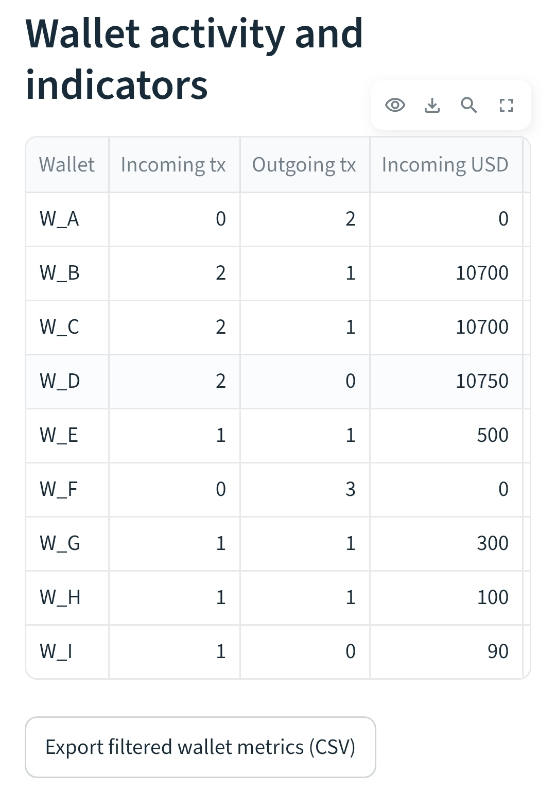
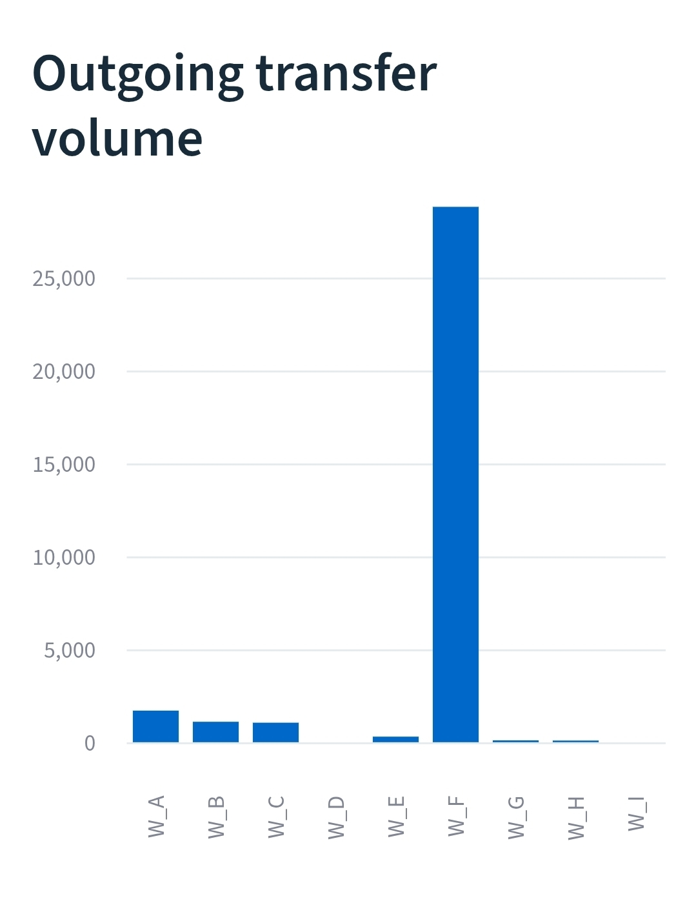
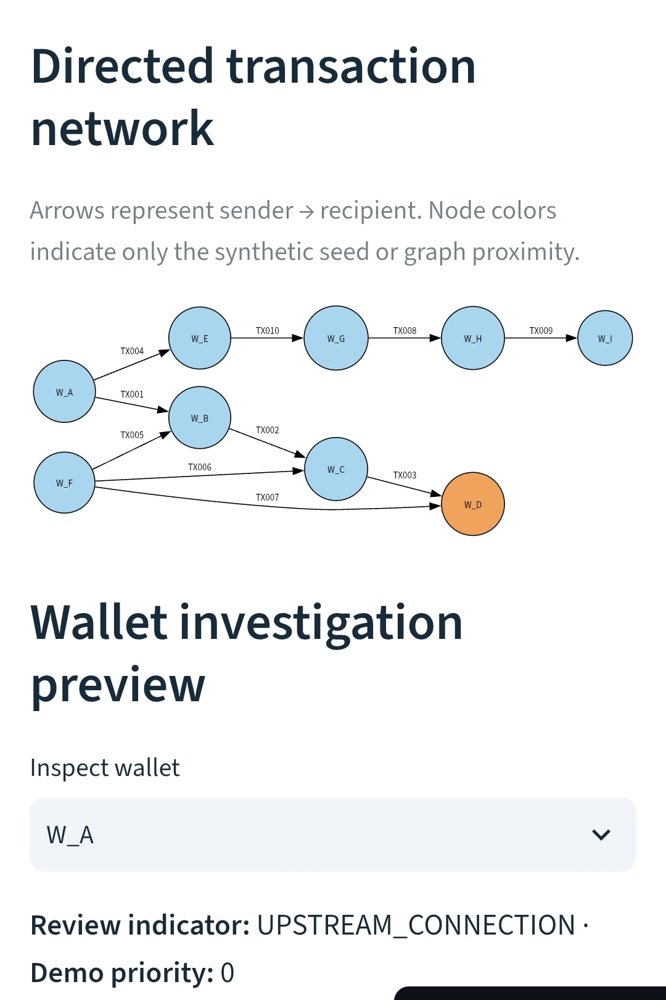
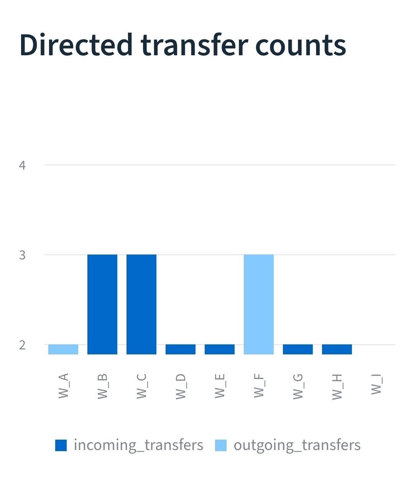

# Blockchain Wallet Risk Analysis

A reproducible **Python + SQL** blockchain intelligence portfolio demonstration using **entirely fabricated wallet transfers**. The project models directed transaction relationships, summarizes wallet activity, and measures graph distance to a **synthetic** review seed. It does not use real wallet addresses or real sanctions/watchlist information.


## Dashboard screenshots

Four screenshots from the live synthetic-data dashboard show the wallet network, transaction activity, metrics, and investigation interface.









## Business question
How can an investigator explore directed wallet-transfer relationships and distinguish graph proximity from evidence of actual fund flows?

## Demonstrated deliverable
A directed wallet-network explorer using synthetic transfers, inbound/outbound wallet metrics, shortest-hop reachability to fabricated seed labels, and transparent demonstration-only prioritization.

## Engineering verification
**7 automated tests** cover graph behavior, invalid records, unreachable wallets, and SQLite-to-Python wallet-metric parity. GitHub Actions runs the suite and reproducible analysis pipeline on each push and pull request.

## Interactive Streamlit dashboard

**[Launch the live wallet network dashboard](https://blockchain-wallet-risk-analysis-ve5ty6mxctevmkvhogjvxl.streamlit.app/)** · [View source code](https://github.com/suntzu2308-bit/blockchain-wallet-risk-analysis)

Explore synthetic wallet relationships through a directed network diagram, wallet and priority filters, transaction tables, comparative charts, and CSV export.

```bash
python -m pip install -r requirements.txt
python -m streamlit run app.py
```

The dashboard is deployed publicly through Streamlit Community Cloud. All wallet labels and transactions are fabricated.

## Run the analysis

Requires Python 3.10+ and standard library only:

```bash
python src/analyze.py
python -m unittest discover -s tests -v
```

The pipeline writes `output/wallet_summary.json` with per-wallet activity metrics, directed graph distance to the fabricated seed, and explainable demo prioritization indicators. GitHub Actions runs the tests and pipeline on pushes and pull requests.

## Skills demonstrated
- **Python:** validated CSV ingestion, graph traversal (breadth-first search), aggregation, JSON reporting
- **SQL:** directed wallet in/out flows, transaction counts, USD-denominated totals, distinct counterparties
- **Financial crime analytics:** transparent synthetic watchlist-seed connections and human-review limitations
- **Engineering:** unit tests, reproducible fixtures, automated CI

## Repository layout
- `data/transfers.csv` — invented transfer network
- `data/seed_labels.csv` — explicitly synthetic watchlist seed
- `src/analyze.py` — validation, wallet metrics and directed graph traversal
- `sql/wallet_metrics.sql` — SQLite wallet metrics
- `tests/test_analyze.py` and `tests/test_sql_parity.py` — graph regression and SQLite parity tests
- `docs/methodology.md` — definitions, assumptions, safeguards and limitations
- `.github/workflows/tests.yml` — CI tests and smoke run

## Methodology and limitations

Edges represent sender → recipient. The distance metric measures **upstream directed reachability** to the fabricated seed, not proof that the same funds traveled through the path. Demo priority scores are arbitrary and **not probabilities or compliance determinations**.

There is no on-chain API integration, real-world attribution, customer data, sanctions matching, entity clustering or time-respecting fund tracing. See [methodology](docs/methodology.md) for detail.

## Status

Live dashboard published. Seven automated tests, including SQL/Python wallet-metric parity, passed in GitHub Actions on the synthetic fixture.

MIT licensed.
